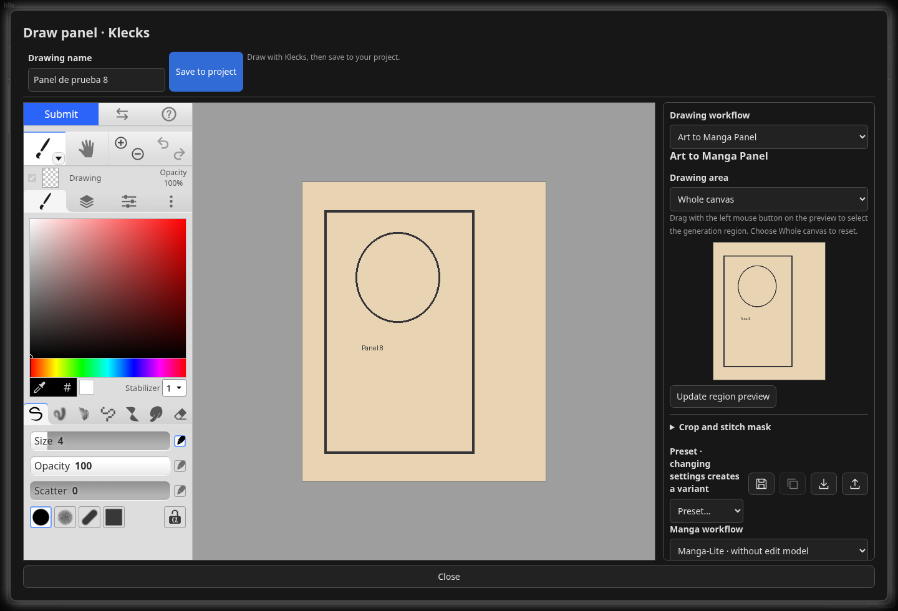

# Drawing and manga conversion in Klecks

[Documentation](README.md) · [Project README](../README.md)

Klecks handles drawing and layered editing; the **Drawing workflow** selector adds generation or manga conversion to that same canvas. The result remains editable before it is saved to the project.

**Draw reference** and **Draw panel**, in each gallery header, open a new canvas with a name, AR and MP. The **Draw with Klecks** context menu action opens an existing image to draw over it. [Klecks](https://github.com/bitbof/klecks) runs in a local iframe with brushes, a stabilizer, layers, selection, shapes, text and filters. **Save to project** or **Submit** saves a PNG usable for inference and a PSD with editable layers. Each subsequent save creates a new version; originals are preserved. Reopening a drawing loads its PSD; an imported or generated image opens as an Original layer plus a transparent Drawing layer. Closing asks for confirmation before discarding drawing changes made since the last save.

*Actual editor with a demonstration drawing and Manga-Lite controls. The screenshot illustrates the interface, not a generated result.*

## Sketch to Art

**Sketch to Art** in the Klecks sidebar sends the **Whole canvas** or a **Selected region** to Krea2 Edit. Use **Update region preview**, drag a rectangle in the preview or enter X/Y/width/height. Dashed guides show the same region on the drawing canvas and follow zoom, panning, rotation and mirroring. They are display-only and are excluded from generation inputs, PNG and PSD. **Generate Sketch to Art** runs on demand. **Realtime on stroke release** starts after Klecks finishes the pencil/brush stroke, including its pressure and smoothing; it does not generate while the pen is held down. Realtime reuses the native preview output and wakes on ComfyUI completion events, with polling as a fallback. Only one job runs at a time. New strokes are combined into a request for the latest drawing, and stale results are skipped. **Cancel generation** targets only this editor's job.

### Models, sampling and presets

Sketch parameters and prompt/settings presets are stored separately for reference and panel drawings in the project. The preset controls at the top of Sketch to Art let you save, load, clone, import and export the structured/free prompt, sampling settings, model overrides, LoRAs, generation region and blending settings without closing Klecks. Editing a selected preset marks it Modified; saving updates it explicitly. Unspecified model settings inherit the global Krea2 Edit configuration. Realtime remains a session toggle and is not enabled by loading a preset. Models, encoder and VAE inherit the global Krea2 Edit configuration and can be overridden in **Models and advanced settings**. The structured prompt, denoise, steps, CFG, seed, sampler, scheduler, Shift, reference fit/fidelity, grounding and LoRA order/strengths are editable. The included graph follows `krea-2-sketch-2-art-workflow-final`: original crop directly into grounded encoding and VAE encoding, without automatic resolution scaling; the same latent for the source patch, target and sampler; Shift after the patch. Defaults are 1 step, CFG 1, Euler, Simple, denoise 0.3, Shift 1.15 and grounding 0. The initial additional LoRAs are `krea2_turbo_2step_rank_64_lora_comfyui.safetensors`, then `sketch_krea_2_identity_edit_r64_512_continue_8000.safetensors`, at strength 1. Select installed copies or install these weights manually; they are not automatically downloaded. The regular global Identity Edit LoRA is not added to this sketch graph. No external workflow file, SimpleText or ImageConcatMulti node is required at runtime.

Lower denoise favors the draft; higher denoise gives the edit model more freedom. Test changes on a selected region before enabling realtime. Realtime is useful when the model and settings are fast enough to keep up with drawing; it remains a session choice.

## Regions, masks and blending

**Layer blending** controls edge feather in pixels and blend opacity. Results are inserted into a dedicated editable AI layer, reused within the editor session. Existing drawing layers and pixels outside the selected region are preserved; Klecks' native undo/redo works for AI updates. **Save to project** or **Submit** saves the composed PNG and layered PSD after generation finishes or is cancelled. Individual generated crops stay in ComfyUI output/history and do not become separate project assets for every stroke; temporary input crops are removed.

**Crop and stitch mask** lets you paint and erase a mask with the mouse on the preview. Enable **Use stitch mask** and choose **Paint mask** or **Erase mask** under **Preview tool**; pink marks show areas to replace. **Crop to mask bounds** sends only their bounding rectangle to inference at the original size. The generated crop is stitched back through mask alpha, inward feather and opacity; pixels outside the mask, including erased holes and previous AI layer content, remain intact. The mask affects compositing only, not model conditioning. Masks stay in the current editor session, while the resulting layer is saved in the PSD. Choosing **Whole canvas** disables the previous stitch mask and returns the preview tool to region selection. **Clear mask** also disables masking. Region selection and realtime remain available.

Choose a rectangle to limit inference, then use a stitch mask when only part of that rectangle should be replaced. Erased mask areas protect existing pixels. This is a compositing mask, not diffusion inpainting conditioning.

## Art to Manga Panel

**Art to Manga Panel** is available in Klecks under **Drawing workflow**. It converts the whole canvas or selected region into an editable layer, with the same crop/stitch mask, cancellation, stale-result protection, native undo and layered saving as Sketch to Art. Manga output fits inside the selected area without stretching; layer opacity remains editable in Klecks.

Choose **Manga-Lite** for Manga Levels → Manga Finish → Manga Panel without an edit model, or **QWEN-Manga** for Qwen Image 2.1 Turbo editing followed by Manga Finish and Manga Panel. Both use the [ComfyUI-MangaScreen workflows](https://github.com/ashukae/ComfyUI-MangaScreen), with their 2 MP working resolution, 250 screen lines and panel defaults. QWEN-Manga uses the upstream eight-step sigma schedule and editable instruction; select a compatible Turbo model, encoder and VAE under Models and advanced settings. Manga settings and presets are saved separately for references and panels. Screentones, levels, crop, frame, paper and ink are editable. **Extract pen lines** is optional and disabled initially; enable it to reproduce the workflow's Manga Lineart pass.

| Control | Effect on the result |
| --- | --- |
| **Input black / Input white / Gamma** in Manga-Lite | Adjust which source values become black, midtone or paper before finishing |
| **Screen lines** | Controls dot frequency; fewer lines produce coarser dots |
| **Paper white point** | Lower values clear more light tone to paper |
| **Solid black point** | Higher values turn more dark areas into solid ink |
| **Light tone / Dark tone / Gradation** | Set tone coverage and smooth-shadow treatment |
| **White lines in black** | Preserves folds and seams inside solid black areas |
| **Panel shape / Crop X / Crop Y** | Choose the crop shape and its position |
| **Panel border / Paper margin / Paper / Printed ink** | Add the printed panel presentation |

Manga-Lite is useful for clean line art and simple backgrounds. QWEN-Manga can redraw painted backgrounds and reinterpret values before the tone pass, but it needs compatible Turbo weights. Manga output is fitted inside the chosen drawing region, so a changed panel aspect ratio keeps its proportions rather than stretching to fill the region. Layer opacity can be changed in Klecks.

Install **ComfyUI-MangaScreen** (`opencv-python`, `numpy`), restart ComfyUI when no jobs are active and refresh lists. Pen extraction additionally needs **comfyui_controlnet_aux** and its Manga Lineart weights. Models and lineart weights must be installed separately. The editor does not automatically download manga models. When pen extraction is explicitly enabled and run, `comfyui_controlnet_aux` may download its missing annotator weights on first use; install them in advance for offline use. Manga generation runs on demand.

## Saving and undo

AI updates use Klecks' native history, so undo and redo apply to layer changes. Saving writes both the composed PNG and the layered PSD. Close the editor after saving to preserve the current drawing; closing with unsaved changes asks whether to discard them. The project gallery receives the saved drawing rather than a separate asset for every preview or stroke.

For required nodes and weights, see [Installation](installation.md). Build and integration details are in [Development](development.md#bundled-klecks-editor).
