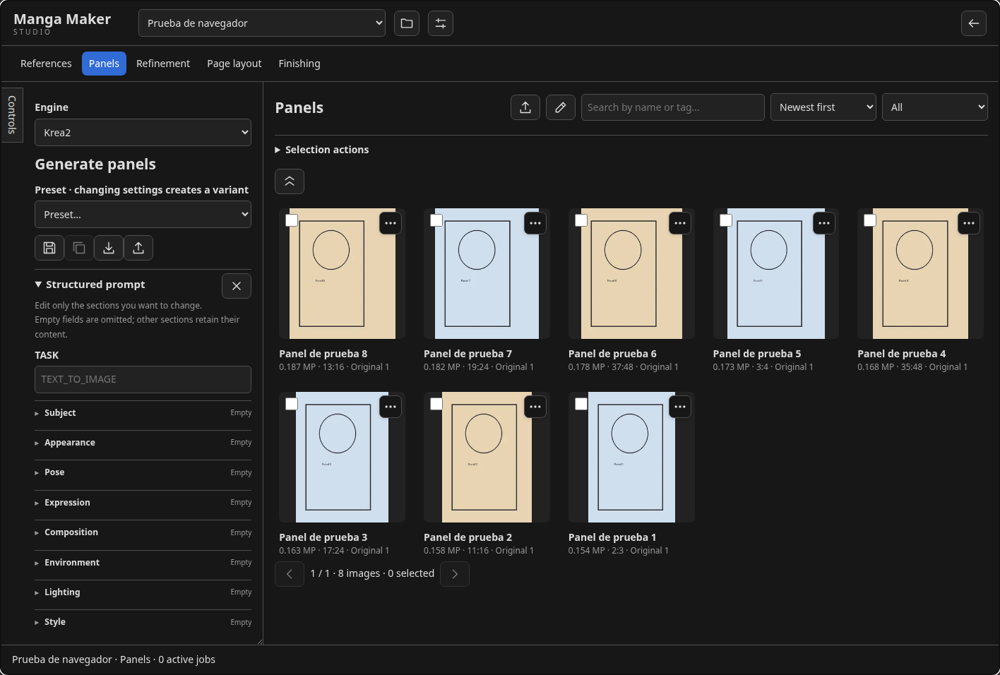

# Using Studio

[Documentation](README.md) · [Project README](../README.md)

Studio is organized around assets and projects: references describe the cast and setting, panels hold individual illustrations, and pages combine those assets into a reading layout. You can import existing art, generate new art, or draw locally. The same project can mix all three.

*Actual Studio interface with demonstration assets from isolated test storage; the sample images are not AI inference results.*

## Workspaces

| Workspace | Purpose | What to configure or select |
| --- | --- | --- |
| **References** | Character, expression, pose, clothing, object and environment references | A generation engine and prompt, imported images or **Draw reference** |
| **Panels** | Illustrations intended for individual manga panels | Prompt, engine, ordered visual references and output size; or imported/drawn art |
| **Refinement** | Edit a reference, panel or complete page while preserving its original | **Original image**, refinement preset, model and relevant sampling controls |
| **Page layout** | Arrange panels, framing and dialogue into a page | Layout geometry, panel images, reading order, borders and text |
| **Finishing** | Refine or redesign an existing composition with Qwen | Source page, finishing mode and reviewed instruction |

The ComfyUI graph remains available outside Studio. Generation runs through the existing queue, while importing, drawing and layout editing do not need a diffusion model.

In **References** and **Panels**, select **moss** or **anima** under **Engine** to generate from text using the corresponding local workflow settings. Both support prompts, presets, AR/MP, seed, sampling overrides and additional model LoRAs. These workflows do not accept connected images; reuse a saved reference prompt through its image menu. Anima also exposes its negative prompt under **Sampling**. Model filenames can be changed under **Models and advanced settings**.

## Working with references and panels

A project keeps references and panels in separate galleries. References can be connected to generation without placing them on a page. Panels can be reused in different layouts; positioning or cropping them in the editor does not alter the source file.

Open image actions with a right-click or the **⋯** button. **Download image** is available for references, panels, pages and connected images; it downloads the original bytes with the correct file extension. The preview’s **Download original file** uses the same download route. The menu supports arrow keys, Enter and Escape. Icon controls have tooltips and accessible labels. Aspect ratios are selected with buttons that visually represent each format.

## Editing with Krea2

**Krea2 · edit** is an **Engine** option in both **References** and **Panels**, based on `krea-2-edit-workflow-final.json`. Select this engine and connect a reference, or use **Edit with Krea2** in an image menu. Models inherit the engine's global configuration; prompts, references, additional LoRAs and individual overrides remain independent between these workspaces. One image is required and up to four references can be connected, in order. For scene/subject edits, put the scene/original first and the subject last. Third and fourth references require an updated `comfyui-krea2edit`; the bridge path additionally requires updated `ComfyUI-Krea2-Qwen8B` nodes; these additional inputs are experimental in the upstream patch. The original is preserved and the result is saved in the active workspace's category; if the source belongs to that category, a new version is created. The prompt uses the same sections and free field. The official configuration uses Turbo with native encoding, 8 steps, CFG 1, Euler, Simple and denoise 1, plus Identity Edit v1.2 at strength 1. Individual settings and presets can override these values. LoRAs for this operation affect only the model, in list order. Identity Edit is applied once before additional LoRAs; if it is also enabled in the individual list, its specified strength is used without applying it twice. The example's two-step Turbo LoRA is neither downloaded nor added. **Conditioning path** lets you switch to Qwen-VL 8B + bridge. Advanced controls include fidelity for the last reference and earlier references, `fit`, grounding and its system prompt.

Under **Connected visual references → Initial latent image**, Krea2 Edit lets you select one connected image as the initial latent in both References and Panels. **Sampling → Denoise** appears when an image is selected: lower values preserve more of that image. **None · empty latent** keeps the empty latent and denoise 1. Selection is tracked by asset ID when references are reordered and cleared if that reference is removed. Inherited size follows the selected image; manual AR/MP resizes and crops only the initial target, preserving the conditioning sources. Scene and subject keep their order. This option works with native or bridge encoding and is stored in operation presets.

## Connected references

**Connected visual references** marks deleted images as **Trash** and missing files as **Missing file**. **Restore reference** recovers a connected image from Trash without changing its position or latent selection; **Remove** disconnects it. Generation errors identify the unavailable image instead of silently skipping it.

Reference order conveys meaning. For scene/subject edits, keep the original scene first and the subject last. Selecting an initial latent controls where sampling starts; it does not reorder the semantic references.

## Reusing prompts

**Use image prompt**, in an image thumbnail's context menu (References, Panels, Refinement or Finishing galleries, or connected references), copies the sections and free field saved when generating the image, replacing the current prompt without changing models or other settings. It also recognizes section labels in saved text; an unstructured saved prompt is copied into Free prompt with empty sections. The action is disabled when the image has no recoverable prompt data. After copying, you can edit each field independently.

Use **Show combined prompt** to inspect what will be sent to the model. Presets provide reusable instructions; [Configuration](configuration.md#prompts-and-presets) explains how their model overrides inherit global settings.

## Refinement and finishing

**Refinement** accepts references, panels and pages through **Original image** or **Refine** in an image menu. Its output becomes a new version in the source category. A Hands or Face preset focuses the instruction on that subject; a Color → Manga preset asks the edit model for a monochrome rendering. For deterministic screentone and frame processing, use [Art to Manga Panel](drawing.md#art-to-manga-panel) in Klecks.

**Finishing** supports Qwen editing or redesign. Refinement instructions preserve the composition and panel boundaries; redesign instructions allow reinterpretation. Each mode stores its instruction independently. **Restore default instruction** restores the bundled instruction. **Generate Text** produces an instruction to review, and Qwen receives the reviewed prompt without additional prefixes; analysis does not automatically start image generation.

## Choosing a practical workflow

For existing finished illustrations, import them into Panels and work directly in [Page layout](page-layout.md). For drawn drafts, open [Klecks](drawing.md), render them with Sketch to Art when useful, and convert the art into manga tones as a separate operation. For consistent characters or locations, maintain reference images in References and connect them in the desired order before generating panels.

Projects preserve originals and versions, so refinement and conversion can be compared against earlier assets. [Projects and storage](projects.md) explains saving, recovery and cancellation.
